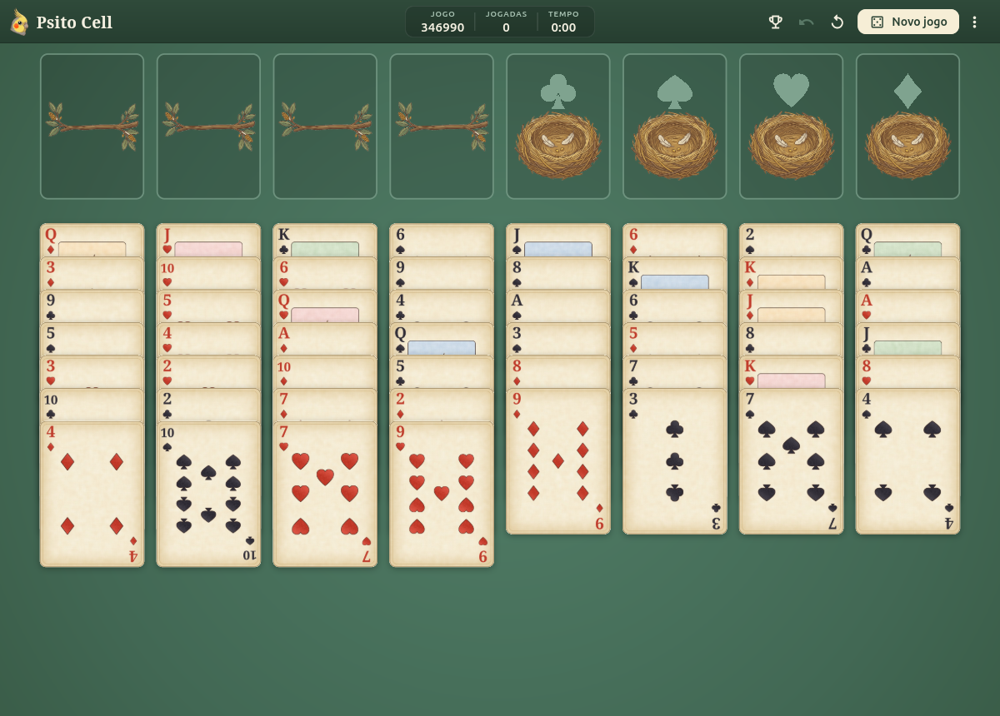

# Psito Cell

A cozy FreeCell-style solitaire with cockatiels, for Windows and Linux, built with
Flutter. No ads, no telemetry and no account: just a little game and some happiness.



**[Website](https://francisceioseph.github.io/psito-cell/)**

## Features

- Classic rules, with four free perches and four nests
- Twelve illustrated face cards, with a different cockatiel for each suit
- Click, drag or double-click to play, with unlimited undo
- Numbered games: the same number always gives the same deal
- Cards that hop, shake their heads at a wrong move and bounce when you win
- A curious cockatiel that peeks at the table when you stop to think
- A local table of your best games, by fewest moves, kept only on your computer
- Keyboard shortcuts: `Ctrl+Z` undoes, `Ctrl+R` restarts and `Ctrl+N` starts a new game
- English and Portuguese

## Install

### On Windows

Windows 10 version 1809 or newer, or Windows 11, on x64. Download
[the installer](https://github.com/francisceioseph/psito-cell/releases/latest/download/psito-cell-windows-x64-setup.exe)
and run it. It doesn't ask for administrator rights.

The installer isn't signed with a paid certificate, so SmartScreen may warn that it
comes from an unknown publisher: choose **More info**, then **Run anyway**. New
versions are installed the same way, over the old one.

### From the APT repository

On Debian 13 or newer, Ubuntu 24.04 or newer, or Mint 22 or newer. It updates along with the system:

```bash
sudo mkdir -p /etc/apt/keyrings
curl -fsSL https://francisceioseph.github.io/psito-cell/psito-cell.asc | sudo tee /etc/apt/keyrings/psito-cell.asc >/dev/null
printf 'Types: deb\nURIs: https://francisceioseph.github.io/psito-cell\nSuites: stable\nComponents: main\nArchitectures: amd64\nSigned-By: /etc/apt/keyrings/psito-cell.asc\n' | sudo tee /etc/apt/sources.list.d/psito-cell.sources >/dev/null
sudo apt update
sudo apt install psito-cell
```

### From the DNF repository

On Fedora, on x86_64. It updates along with the system, and the first install asks you to accept the signing key:

```bash
sudo curl -fsSL -o /etc/yum.repos.d/psito-cell.repo https://francisceioseph.github.io/psito-cell/psito-cell.repo
sudo dnf install psito-cell
```

### From the source

You need Flutter 3.47 and the system libraries. On Debian, Ubuntu or Mint:

```bash
sudo apt install libgtk-3-dev ninja-build cmake clang pkg-config
```

Then build a package that installs for everyone, and needs no Flutter to run:

```bash
tool/build-deb.sh
sudo apt install ./build/deb/psito-cell_*_amd64.deb
```

## Develop

```bash
flutter run -d linux
flutter analyze
flutter test
```

The rules live in `lib/src/game/`, in Dart with no interface, and the table, the cards
and the animations in `lib/src/ui/`. Texts live in the `.arb` files in `lib/l10n/`, in
both languages. `tool/prepare_art.py` turns the original illustrations into `assets/`.

## Psito Games

Psito Cell is the first game of Psito Games, a suite of casual games made in the spirit
of the ones that came with Windows 7. It shares its name and its birds with
[Psito OS](https://github.com/francisceioseph/psito-os), but it doesn't depend on it.

## License

The code is under the [Apache License 2.0](LICENSE) and the card art under
[CC0](assets/LICENSE.md). See [the third-party licenses](THIRD_PARTY_LICENSES.md).
